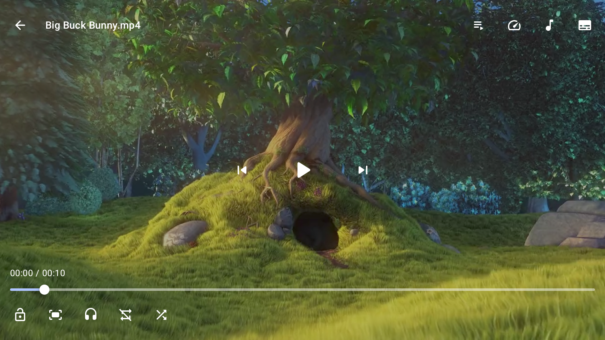
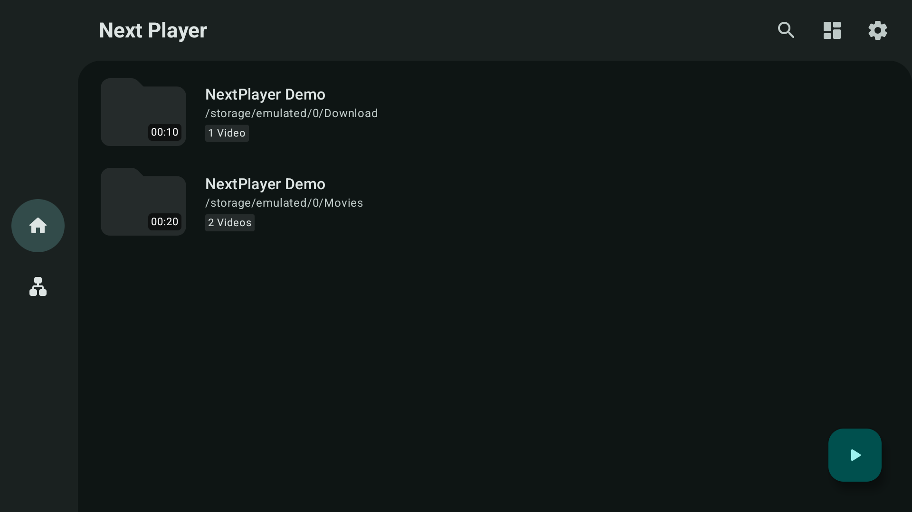
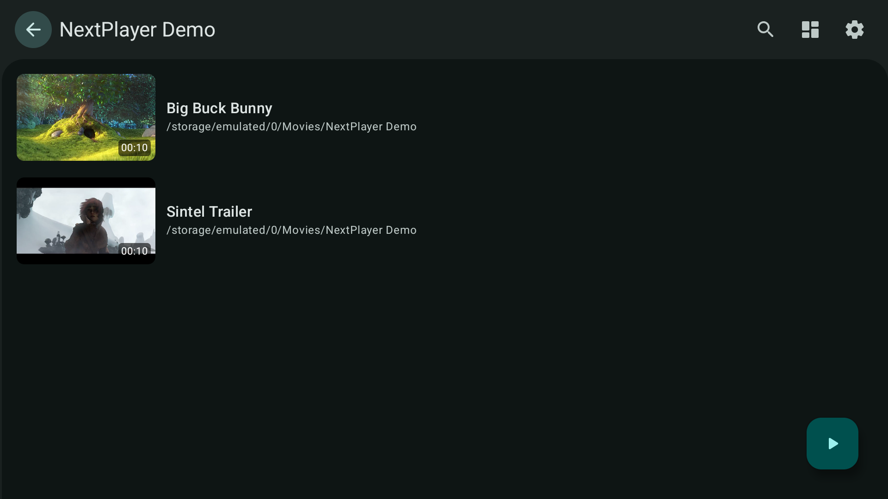
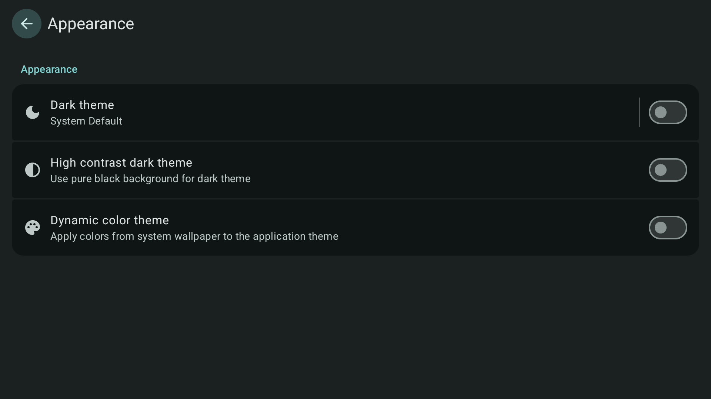

# Next Player

[](https://github.com/anilbeesetti/nextplayer/releases/latest)
[](https://play.google.com/store/apps/details?id=dev.anilbeesetti.nextplayer)
[](https://apt.izzysoft.de/fdroid/index/apk/dev.anilbeesetti.nextplayer)
[](https://f-droid.org/packages/dev.anilbeesetti.nextplayer)
[](https://github.com/anilbeesetti/nextplayer/releases/latest)
[](https://play.google.com/store/apps/details?id=dev.anilbeesetti.nextplayer)
[](https://hosted.weblate.org/engage/next-player/)

Next Player is an Android native video player written in Kotlin. It provides a simple and easy-to-use interface for users to play videos on their
Android devices

**This project is still in development and is expected to have bugs. Please report any bugs you find in
the [Issues](https://github.com/anilbeesetti/nextplayer/issues) section.**

[](https://play.google.com/store/apps/details?id=dev.anilbeesetti.nextplayer)
[](https://apt.izzysoft.de/fdroid/index/apk/dev.anilbeesetti.nextplayer)
[](https://f-droid.org/packages/dev.anilbeesetti.nextplayer/)

> For Github releases, you can verify the app with the SHA-256 fingerprint certificate: `D3:7C:AB:F3:67:6C:F5:82:24:FB:24:2C:8D:D2:09:12:9D:05:88:03:79:29:5F:AA:A6:D0:FB:60:7B:EC:13:1B`

## Screenshots

### Phone

<div style="width:100%; display:flex; justify-content:space-between; flex-wrap:wrap; gap:8px;">

[](fastlane/metadata/android/en-US/images/phoneScreenshots/1.png)
[](fastlane/metadata/android/en-US/images/phoneScreenshots/2.png)
[](fastlane/metadata/android/en-US/images/phoneScreenshots/3.png)
[](fastlane/metadata/android/en-US/images/phoneScreenshots/4.png)
[](fastlane/metadata/android/en-US/images/phoneScreenshots/6.png)
[](fastlane/metadata/android/en-US/images/phoneScreenshots/7.png)
[](fastlane/metadata/android/en-US/images/phoneScreenshots/8.png)
</div>

### Player UI

<div style="width:100%; display:flex; justify-content:space-between;">

[](fastlane/metadata/android/en-US/images/phoneScreenshots/5.png)
[](fastlane/metadata/android/en-US/images/tvScreenshots/3.png)
</div>

### Android TV

<div style="width:100%; display:flex; justify-content:space-between; flex-wrap:wrap; gap:8px;">

[](fastlane/metadata/android/en-US/images/tvScreenshots/1.png)
[](fastlane/metadata/android/en-US/images/tvScreenshots/2.png)
[](fastlane/metadata/android/en-US/images/tvScreenshots/4.png)
</div>

## Player intent API

Next Player accepts the [MX Player VIEW intent contract](https://mx.j2inter.com/api)
requested in [#2017](https://github.com/anilbeesetti/nextplayer/issues/2017).
Clients supporting `com.mxtech.videoplayer.ad` (MX Free) or `com.mxtech.videoplayer.pro`
(MX Pro) can use the same extras with `dev.anilbeesetti.nextplayer`. Select Next
Player's package explicitly; an intent addressed to an MX package launches MX.
Debug builds use `dev.anilbeesetti.nextplayer.debug`.

```kotlin
val intent = Intent(Intent.ACTION_VIEW).apply {
    setClassName(
        "dev.anilbeesetti.nextplayer",
        "dev.anilbeesetti.nextplayer.feature.player.PlayerActivity",
    )
    setDataAndType(videoUri, "video/*")
    putExtra("title", "Example")
    putExtra("position", 30_000) // milliseconds, overrides saved resume position
    putExtra("subs", arrayOf(subtitleUri)) // Uri[], also accepts legacy ArrayList<Uri>
    putExtra("subs.name", arrayOf("English"))
    putExtra("subs.enable", arrayOf(subtitleUri))
    putExtra("headers", arrayOf("User-Agent", "Example/1.0"))
    putExtra("return_result", true)
    addFlags(Intent.FLAG_GRANT_READ_URI_PERMISSION)
}
// Launch with an Activity Result launcher to receive the playback result.
launcher.launch(intent)
```

For `content://` media, grant access to every video and subtitle URI, including
additional URIs through `ClipData` when needed. The player activity also accepts
implicit VIEW intents with an appropriate MIME type.

| Extras | Behavior |
| --- | --- |
| `video_list`, `video_list.name` | Ordered URI queue and optional per-item titles; playlist names take precedence over `title`. |
| `video_list_is_explicit` | `true` plays the full queue even when autoplay is disabled; otherwise autoplay preferences apply. |
| `subs`, `subs.name`, `subs.filename`, `subs.enable` | Subtitle URIs, labels, filename hints for format detection, and initial selection. Media3 displays one text track at a time. |
| `headers` | Alternating header names and values, scoped to the request's videos, manifests, segments, and HTTP subtitles. |
| `decode_mode` | Byte `1` (HW) and `4` (HW+) select hardware decoding; `2` (SW) selects FFmpeg. |
| `video_zoom` | `0` stretch, `1` fit, `2` original size, `3` crop. |
| `DAR_horz`, `DAR_vert` | Positive finite floats overriding the display aspect ratio. |
| `video`, `sticky` | Video visibility and a request-specific background playback override. |
| `orientation` | Android orientation constants `-1`, `0`, `1`, `6`, `7`, `8`, `9`, `10`; `99999` follows video orientation. |
| `keys.dpad_up_down` | With controls hidden, `0` adjusts volume, `1` selects next/previous media. |
| `suppress_error_message` | Skips a failed video when another is available, otherwise closes without an error dialog. |
| `secure_uri` | Next Player has no URI property dialog; playback titles do not expose the full URI. |

Set `sticky=true` to keep playback running when the activity goes into the
background, or `sticky=false` to disable automatic background playback for that
request. This does not launch the player directly into the background; exiting
with Back still stops playback. Playback speed follows the player session and
default speed setting; the intent API currently has no playback-speed extra.

Results use action `com.mxtech.intent.result.VIEW`, the last media URI as data,
`end_by` (`user` or `playback_completion`), and the actual `decode_mode` when known.
For incomplete playback, known `position` and `duration` are integer milliseconds;
completed playback omits them. Result codes are `RESULT_OK` for played media,
`RESULT_CANCELED` before playback starts, and `RESULT_FIRST_USER` for playback errors.
Only `return_result=true` requests a callback.

Compatibility limits: deprecated `fast_mode` is ignored. MX's OpenSubtitles search
hints (`size`, `filename`, `hash.opensubtitles`, and their `video_list.*` forms)
are ignored because Next Player does not provide that search service. SAMI
multi-track fragments require a subtitle format supported by Media3. Network API
subtitles load through Media3 so request headers are preserved; local subtitle
encoding conversion continues to use the configured encoding.

## Supported formats

- **Video**: H.263, H.264 AVC (Baseline Profile; Main Profile on Android 6+), H.265 HEVC, MPEG-4 SP, VP8, VP9, AV1
    - Support depends on Android device
- **Audio**: Vorbis, Opus, FLAC, ALAC, PCM/WAVE (μ-law, A-law), MP1, MP2, MP3, AMR (NB, WB), AAC (LC, ELD, HE; xHE on Android 9+), AC-3, E-AC-3, DTS,
  DTS-HD, TrueHD
    - Support provided by ExoPlayer FFmpeg extension
- **Subtitles**: SRT, SSA, ASS, TTML, VTT, DVB
    - SSA/ASS has limited styling support see [this issue](https://github.com/google/ExoPlayer/issues/8435)

## Features

- Native Android app with simple and easy-to-use interface
- Completely free and open source and without any ads or excessive permissions
- Software decoders for h264 and hevc
- Audio/Subtitle track selection
- Vertical swipe to change brightness (left) / volume (right)
- Horizontal swipe to seek through video
- [Material 3 (You)](https://m3.material.io/) support
- Media picker with tree, folder and file view modes
- Play videos from url
- Play videos from storage access framework (Android Document picker)
- Control playback speed
- External Subtitle support
- Zoom gesture
- Picture-in-picture mode
- Background playback
- Android TV version
- Search Functionality
- Subtitle delay
- Network storage support (SMB/FTP/SFTP/WebDAV)

## Planned Features

- External Audio support
- Online subtitles download

## Contributing

Contributions are welcome!

### Developer documentation

- [Runtime decoder switching](feature/player/DECODER_SWITCHING.md)

### Translating

You can help translate Next Player on [Hosted Weblate](https://hosted.weblate.org/engage/next-player/).

[](https://hosted.weblate.org/engage/next-player/)

## Credits

### Open Source Projects

- [Findroid](https://github.com/jarnedemeulemeester/findroid)
- [Just (Video) Player](https://github.com/moneytoo/Player)
- [LibreTube](https://github.com/libre-tube/LibreTube)
- [ReadYou](https://github.com/Ashinch/ReadYou)
- [Seal](https://github.com/JunkFood02/Seal)
- ...

### Special Thanks

[](https://hosted.weblate.org/engage/next-player/)

Thanks to **Weblate** for providing free hosting for the project.

## License

Next Player is licensed under the GNU General Public License v3.0. See the [LICENSE](LICENSE) file for more information.
