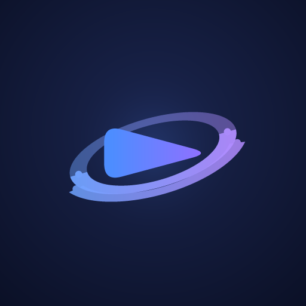
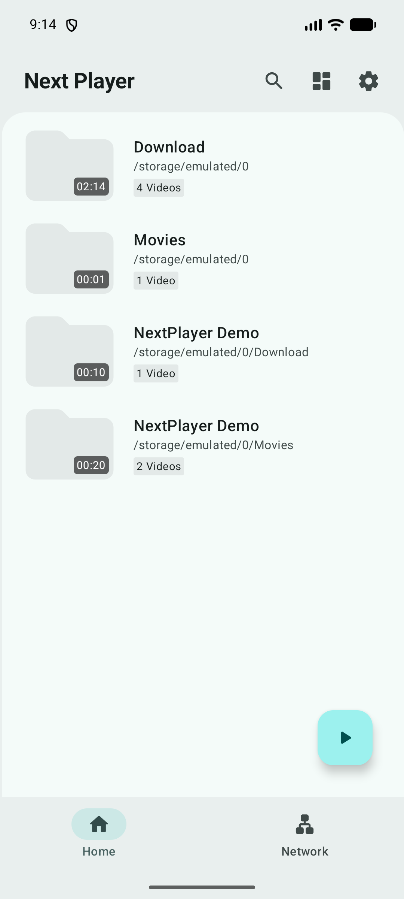
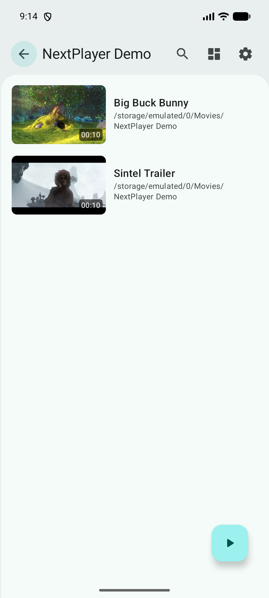
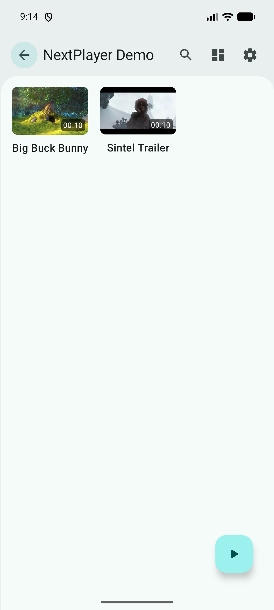
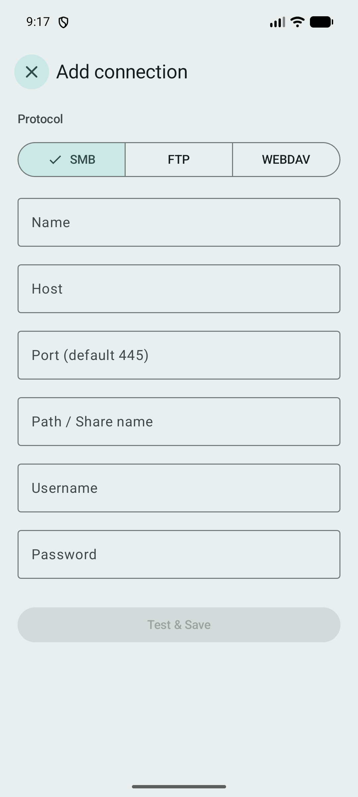
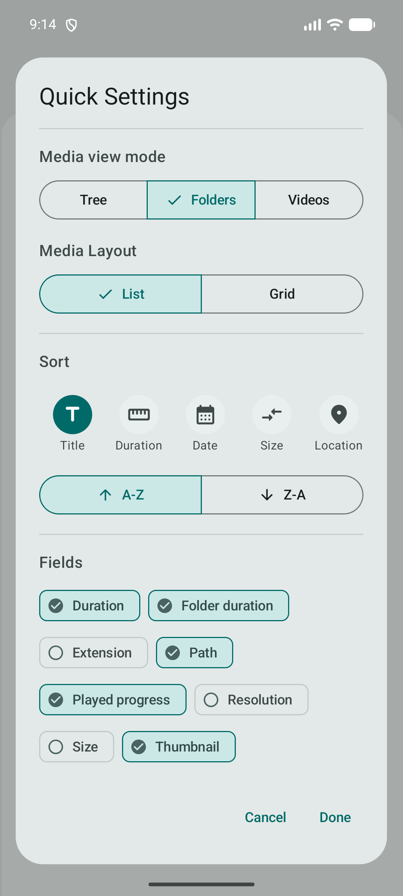
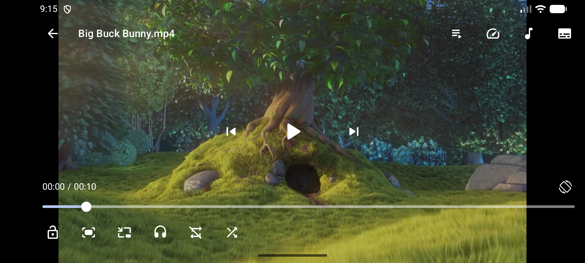
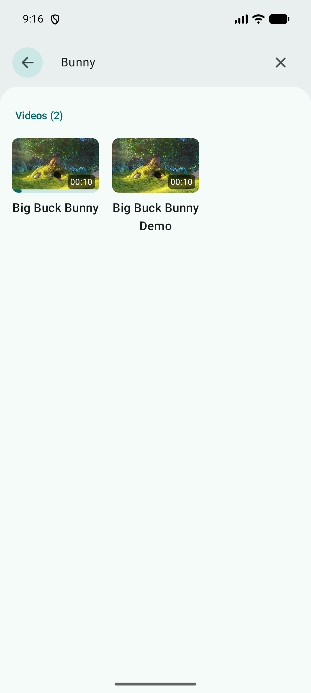
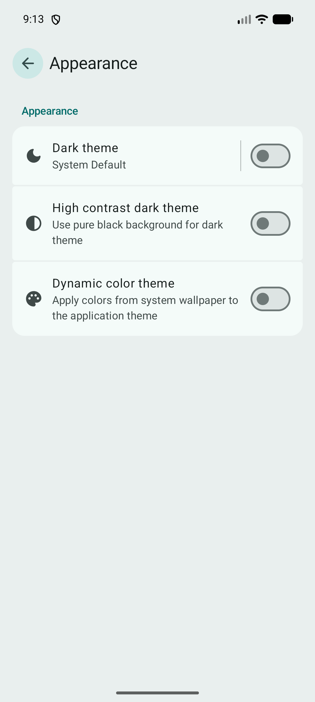

<p align="center">
  
</p>

<h1 align="center">Graviton</h1>

<p align="center">
  <strong>A modern, high-performance Android media player built with Jetpack Compose & AndroidX Media3</strong>
</p>

<p align="center">
  Graviton offers a seamless, distraction-free video and audio playback experience for Android. Built from the ground up with modern Jetpack Compose UI and low-latency hardware decoding, Graviton combines performance, privacy, and extensive format support into a sleek, Material 3 Expressive interface.
</p>

<p align="center">
  <a href="https://github.com/librespark-crypto/graviton/releases/latest">
    
  </a>
  <a href="LICENSE">
    
  </a>
  <a href="https://developer.android.com">
    
  </a>
  <a href="https://github.com/librespark-crypto/graviton/actions">
    
  </a>
</p>

<p align="center">
  <a href="#screenshots">Screenshots</a> •
  <a href="#key-features">Key Features</a> •
  <a href="#installation">Installation</a> •
  <a href="#building-from-source">Building from Source</a> •
  <a href="#architecture">Architecture</a> •
  <a href="#contributing">Contributing</a> •
  <a href="#credits--license">Credits & License</a>
</p>

---

## Screenshots

<p align="center">
  
  
  
  
</p>

<p align="center">
  
  
  
  
</p>

---

[](https://github.com/librespark-crypto/graviton/actions/workflows/build.yml)
[](LICENSE)
[](https://github.com/librespark-crypto/graviton/releases/latest)

> Graviton is a fork of Next Player focused on true hardware decoding and Glass UI.

## Screenshots


## What changed vs Next Player
- True HW-only mode (no silent SW fallback)
- Glass UI blur on Android 12+
- Hold-to-speed with horizontal slide (like mpv)
- 12 Material 3 themes + diagnostics overlay
- New G-orbit icon

## Decoder Modes
| Mode | Behavior |
| --- | --- |
| Auto | HW+ -> HW -> SW |
| HW | HW only, error if fails |
| HW+ | HW+ only |
| SW | Software only |

## Architecture
Multi-module: app, core:ui, core:model, core:datastore, feature:player, etc.

## Build
```bash
./gradlew assembleDebug
```

## Credits
Original Next Player by Anil Singh. Licensed GPL-3.0.
