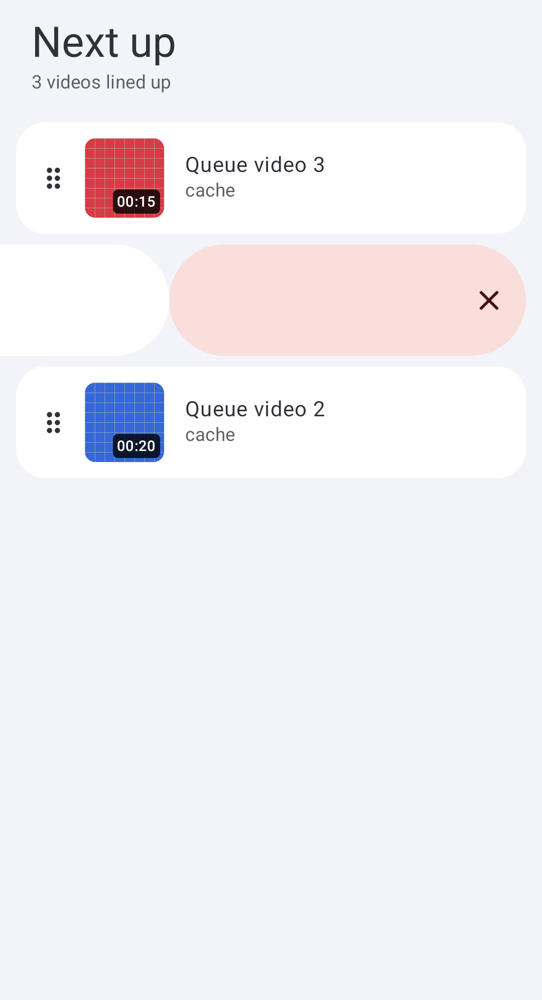
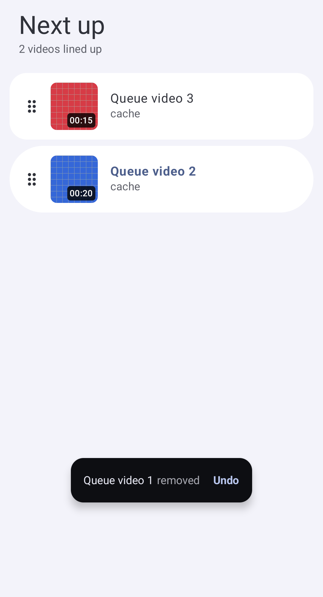

# Dismissal reference correction

This round corrects the user's two remaining dismissal mismatches. The pinned PixelPlayer reference is `63cb59b97aff1d60c5aa46afdf5ce489e632b267`; its `DismissUndoBar`, queue swipe container and queue Undo holder informed the observed behavior. This implementation is independently written using existing Compose and Next Player components. No reference source/assets or dependencies were added.

| Before | After | Why |
| --- | --- | --- |
| Playback dismissal showed a generic snackbar below the compact anchor. | A compact-height pill replaces the mini player at the same anchor, with a full-height shrinking primary-tinted fill, filled Undo button and circular Close button. It enters from below and exits upward with fading. | Matches the reference's replacement surface and four-second feedback. |
| A short queue drag moved the row directly and revealed a full-width background. | The first 60 dp of drag resists to 20 dp, then springs into free drag. Only the translated width reveals the rounded error-color capsule. Threshold feedback, 180 ms exit and cancellation spring-back remain. | Matches the reference's tension, reveal geometry and release behavior. |
| A normal queue row kept an X alongside its swipe removal. | Touch rows show the six-dot handle without a redundant X. A Remove accessibility action and a keyboard-focus Remove button remain. | Matches the reference while preserving assistive and D-pad access. |
| Queue removal had no restoration surface. | A floating inverse-surface bar names the removed video, shows muted “removed” text and offers Undo for four seconds. It restores the exact occurrence near its surviving neighbors without selecting it or resuming playback. | Matches the reference queue Undo and protects duplicate items and paused intent. |

The mini-player fill uses the service's monotonic dismissal deadline; Close hides the surface without extending retention. Expiry, new playback and PIN/fullscreen exclusions remain enforced. Exiting controls are disabled and hidden from accessibility. A fast reversal exits in the raw finger direction even when spring animation trails behind it.

Queue Undo retains the complete MediaItem, including subtitle configuration and metadata. It belongs to the mounted queue surface and disappears when that surface closes. A replacement/stopped queue invalidates Undo, including replacement with the same URI. Metadata enrichment cannot revive playback if Stop or another playback request arrives before an asynchronous addition finishes. Existing external URI access remains retained until the service's normal release/Stop cleanup.

## Verification

Root checks pass with **927 tests in 159 XML suites, zero failures/errors/skips**, plus both debug distributions and instrumentation APKs and ktlint. Final device results are recorded in [verification](verification.md). Regressions cover resisted short drags, reveal bounds in RTL, normal/focused removal actions, duplicate occurrence restoration, neighboring reorder, expiry and replacement/Stop, retained external URI/subtitle access, disabled exit controls, raw-direction exit and four-second local playing/paused restoration.

The countdown test uses bounded manual Compose frames because automatic test idling advances finite animations and timeout effects past the observation window. The restoration test separately checks wall-clock time remains below the unchanged four-second service limit. An initial combined run also exposed a fullscreen-return test cleanup race in Media3 listener cancellation; that test now awaits destruction of the separate fullscreen Activity and drains Compose work before Main assertions. The restoration timing artifact records both clocks; no production timeout was extended.

## Evidence

Captures use generated video fixtures on the existing Pixel_6a, API 37, arm64. The compact pill retains the mini player's left/right/bottom bounds. These are Next Player captures, not a same-version runtime comparison with PixelPlayer.

| Undo at entry | Countdown after one second |
| --- | --- |
|  |  |

| Queue swipe reveal | Queue removal Undo |
| --- | --- |
|  |  |

[Timing evidence](dismissal/reference-undo-clock.json) records 183 ms wall time before each playing/paused Undo submission. An architect reviewed the finished source and four captured states without finding a blocker. [Local test totals](dismissal/local-test-results.json) and [device case results](dismissal/device-test-results.json) retain the verification counts. The preceding [queue report](queue-review.md) is historical where it describes a compact removal reveal or always-visible Remove buttons; this correction supersedes those details.

Physical haptic feel, physical Cast receiver timing and same-version PixelPlayer runtime parity remain unverified. The known high-bitrate 4K Cast buffering limitation is unchanged.
