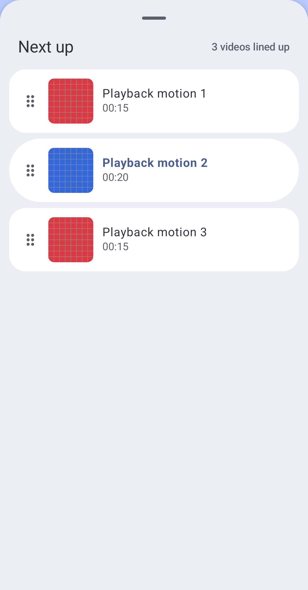
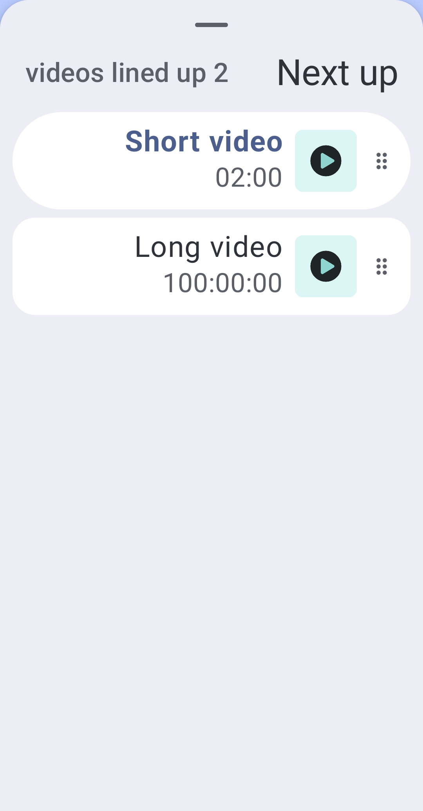

# Queue duration subtitles

The user chose duration as the queue row's subtitle. Rows now show the video title with its formatted duration beneath it, replacing the per-row folder/device text. Artwork stays at 60 dp and has no badge. Unknown duration retains the existing marker. The shared component also updates the fullscreen video queue.

| Before | After | Why |
| --- | --- | --- |
| A duration badge was constrained by the artwork and its padding. | Duration uses the subtitle column below the title. | Long timestamps and larger text have more room; the image needs no text-size scaling. |
| Tests checked badge bounds. | Tests check subtitle placement, full character coverage, no ellipsis, glyph width/height and row containment. | Compose's String semantics can reconstruct a paragraph wider than its rendered text; hasVisualOverflow alone gives false positives. |

## Verification

Both debug distributions/test APKs, root tests and ktlint pass. XML reports **987 local tests in 170 suites, zero failures/errors/skips**. All 17 shared queue regressions pass, including the fullscreen caller. On Pixel_6a API 37 arm64, **two Play and two standard instrumentation cases pass**: normal artwork paging/queue select/reorder/removal, and a real global queue at 200% text in RTL with a synthetic 100-hour metadata duration. They assert full text coverage, no ellipsis, glyph and row bounds. These are focused UI runs; the previous broader playback acceptance is documented separately.

The final source review found no blocker. Both captured frames were inspected. Play is installed on the connected OPPO CPH2689 / API 36, preserving app data without opening playback. Physical-phone interaction and Cast were not retested.

## Captures

Only generated media fixtures appear. This supersedes the artwork-badge examples in earlier queue reports.

| Normal text | 200% text / RTL |
| --- | --- |
|  |  |
