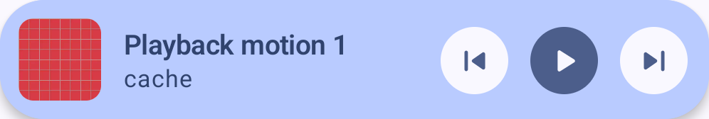
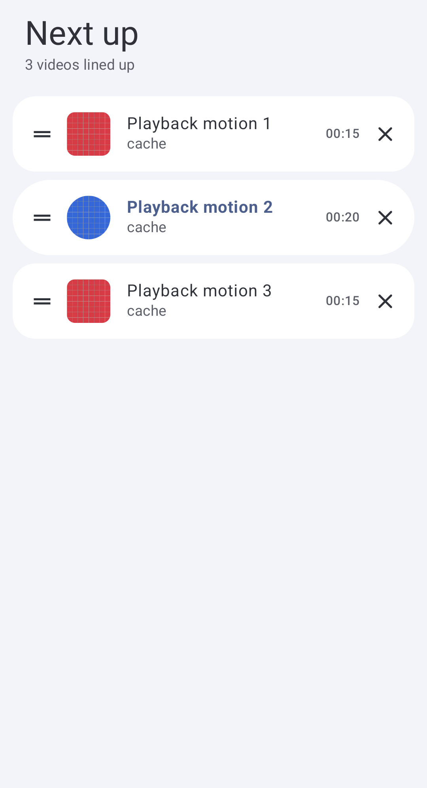
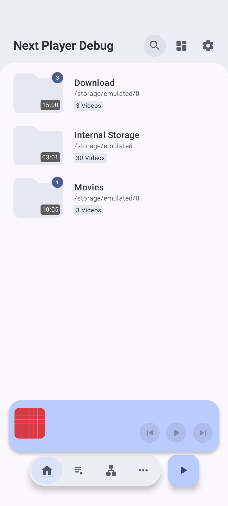
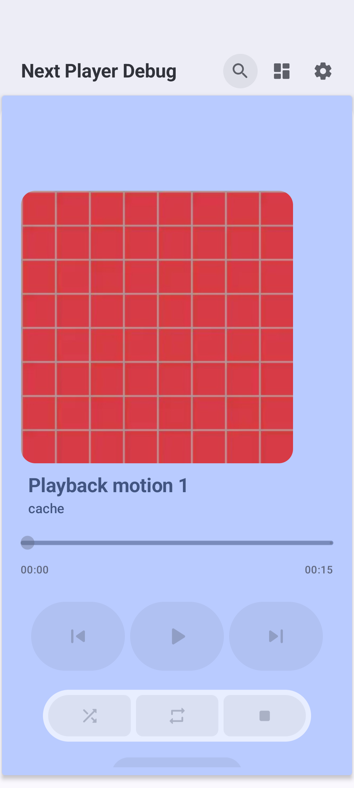
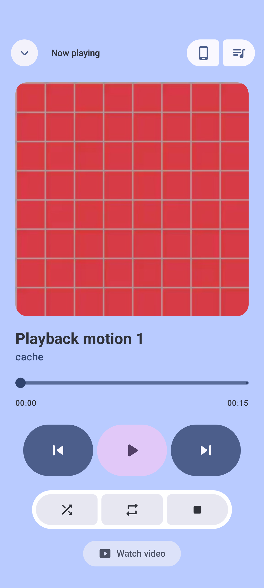

# Playback motion follow-up

This follow-up implements the user's six findings after the prior source-parity reviews. It stays in the third stack layer; parent PRs #2086 and #2087 remain unchanged. The updated requirements are in [the design](../global-playback-controls.md).

| Before | After | Why |
| --- | --- | --- |
| Expanded seek progress used the overlay's 500 ms snapshot. | The seek/time composable uses installed Media3 progress observation at 16 ms media-time resolution. Connecting/Lost do not observe the live player. | Small clips no longer advance in visible 2.5–5% jumps, without refreshing the entire overlay every frame. Playback speed still governs Media3 scheduling. |
| Carousel identity was the complete MediaItem and drag release reset artwork translation. | Native horizontal pages use timeline occurrence identity, keep adjacent pages composed and distinguish user settling from service/index synchronization. | Artwork/duration enrichment does not replay a selection transition; duplicate items remain distinct and RTL follows the native pager. |
| Compact artwork was round and was replaced immediately by a separately laid-out expanded image. | Square compact artwork, one retained painter and a decorative artwork/text layer interpolated between measured fixed endpoint bounds. Metadata fades where its path would cross the growing image, then returns below it; controls use that same visibility and expansion progress. | Opening, closing and interrupted dragging have a continuous visual path. Hidden controls do not accept actions/focus or appear to accessibility. |
| Navigation-bar/rail gates moved the compact anchor immediately while browsing decorators were recreated with padding changes. | One animated extent controls reservation and compact anchoring; entry decorators retain identity and read the latest padding. | Browsing transitions keep the playback view mounted and avoid an independent positional jump. |
| The global queue wrapped another overlay in a fixed 500 dp box, with wide thumbnails and missing unplayed durations. | One responsive queue sheet, Next up/count header, compact rounded rows and explicit duration text. Service enrichment preserves supplied duration and fills database duration; timeline/current duration provide fallback. | Keeps queue actions clear and shows an unknown marker only where no duration is known. No per-row file probing. |
| Playing/pausing shrank artwork and moved the collapse inset. | Stable artwork size and collapse inset. | Implements the user's explicit request to remove this motion. |

## Verification

Root checks pass: `assembleDebug :app:assemblePlayDebugAndroidTest :app:assembleStandardDebugAndroidTest test ktlintCheck --max-workers=2 '-Dorg.gradle.jvmargs=-Xmx4096m -Dfile.encoding=UTF-8'`. XML totals: **877 tests in 155 suites, zero failures/errors/skips**. XML is checked because unit tests use `ignoreFailures=true`.

Existing Pixel_6a, API 37, arm64: **33 Play + 16 standard acceptance tests pass**, with zero failure/error status codes. After the final metadata-staging adjustment, the 15-case Play UI group and 16-case standard UI/external group passed again. Queue removal-to-one and immediate cleanup passed in the focused rerun and both distribution acceptance runs. The generated-video checks sample at least six distinct progress values in a sub-500 ms window for each duration/speed pair, verify pause stability and a half-duration seek, and exercise actual red/blue thumbnails across duplicate queue occurrences. Queue checks show 00:15/00:20 before reorder/removal and preserve the final item. A previously failing removal stress case no longer reads mutable queue count while applying semantics.

Playing UI tests use an explicitly controlled Compose clock and bounded frame/layout waits; real ExoPlayer playback uses wall time. Gesture release is processed before the next gesture, avoiding a stale native drag state in the test harness. The held endpoint checks retain their original 1.5-physical-pixel tolerance. Progress and queue observers register/remove player listeners on the UI dispatcher.

The navigation regression retains the same compact semantics node and observes intermediate/final positions without a jump. A fixture simulates an 80 dp rail in the portrait Pixel_6a window and samples a pixel outside the moving sheet to verify full-rectangle clipping. This is not a physical tablet run.

All four light/dark × portrait/landscape artwork regions have identical bounds and **zero changed pixels** between paused and playing captures. There are 13 current PNGs and 10 JSON geometry files. 

Test clips are independently generated red/blue grid videos (15 and 20 seconds), with no third-party or private media. New device regressions cover progress at 1×/2×, pause/seek, real thumbnail paging including duplicate items, queue duration/reorder/removal and compact navigation continuity. Shared tests cover interruption/reversal, sampled LTR/RTL intermediate bounds, visible metadata never crossing the artwork, hidden control gating and metadata updates without unintended seeks. Saved intermediate-frame JSON confirms that visible metadata is separate from the artwork. An architect recheck of the corrected source and frames found no remaining blocker.

The earlier [source parity review](parity-review.md) describes historical screenshots before this motion follow-up. Same-version PixelPlayer playback runtime comparison and physical Cast remain unverified. No reference code/assets, dependencies or fastlane files are included.

## Current screenshots

| Compact | Expanded | Queue |
| --- | --- | --- |
|  |  |  |

| Expansion start | Intermediate frame | Settled |
| --- | --- | --- |
|  |  |  |

Additional evidence: [blue thumbnail](motion/motion-expanded-blue.png), [short-video seek](motion/short-video-paused-seek.png), [landscape playing](motion/light-landscape-playing.png), [landscape paused](motion/dark-landscape-paused.png), [portrait rail fixture](motion/motion-portrait-rail.png). The magenta rail belongs only to the clipping test fixture.
