# Playback design parity: second round

Scope: third layer only, on `cast/global-playback-controls`, above #2086 and #2087. Next Player colors, typography, icons and video/Cast actions remain the approved application differences. No reference source or assets are incorporated into the application.

## Reference and comparison limits

The reference source is pinned at `63cb59b97aff1d60c5aa46afdf5ce489e632b267`. That source was successfully built locally with its Gradle 9.5.1 distribution verified against the checked-in SHA-256. The public `0.7.5-beta` arm64 APK (release commit `f8eaf743b64ada6d77b309555411fba47cae6bcd`) was installed on the existing Pixel_6a emulator and its setup completed. It is an older version than the source pin.

Reference navigation did not reach playback. The Device CLI first rejected a Library selector, then its required snapshot/selector retry failed with `AMBIGUOUS_MATCH` (group and text both labeled Library). Manual device automation stopped under the tool's failure rule. Thus this round compares the pinned source geometry/behavior and repository reference images against Next Player's actual instrumentation captures; it does not establish a fresh same-version runtime comparison. The reviewer receives this limitation explicitly.

## Corrections

| Before | After | Why |
| --- | --- | --- |
| Landscape retained the portrait header and required scrolling to reach the lower controls. | Full-height artwork/controls columns, 9 dp separation, output and queue beside metadata, collapse over artwork. All controls fit at Pixel_6a landscape size. | The reference hides its top bar in landscape and distributes metadata, progress and controls down the right column. |
| Header actions were 44 dp squares separated by 2 dp, always showing a Cast icon. | 50 × 42 dp chips, 6 dp separation, asymmetrical outer corners, local-phone/remote-Cast icon and a bounded receiver label in portrait. | Matches the reference grouping and distinguishes the active output. Touch targets remain at least 48 dp. |
| The 190 dp receiver label could squeeze narrow landscape metadata. | Landscape keeps the output chip compact; full receiver text remains in metadata/accessibility text. | A long receiver name cannot displace the title. A narrow Cast regression preserves at least 120 dp for metadata. |
| Large, tight wave: 16 dp container, 20 dp wavelength, 4 dp stroke, no gap or end marker. | Material wave's 10 dp container, 40 dp wavelength, 5 dp stroke, 20 dp/s travel, 3 dp end marker and state-specific thumb gap. | Matches the actual expanded reference slider rather than the separate older seek-bar implementation. |
| Round thumb and moving wave remained during scrubbing. | Thumb animates from 16 dp circle to 6 × 24 dp line over 250 ms; the wave flattens during scrubbing/paused/unavailable playback and its animation stops. | Matches the reference interaction without replacing native slider semantics, touch or keyboard support. |
| Faint translucent header/mode surfaces and secondary text; inactive seek track at 20% opacity. | Paired Next Player color roles for controls and text; inactive track at 70%. | Readable foregrounds retain 4.5:1 and inactive track at least 3:1 across tested themes. The stronger inactive track is an intentional accessibility difference from the reference. |
| Previous/next used light secondary containers while play used primary. | Previous/next use primary/onPrimary; play uses tertiaryContainer/onTertiaryContainer. | Restores the reference's visual emphasis using Next Player's palette. |

The artwork pause-scale settles over 260 ms. Native Material expressive controls provide press feedback. Existing service, queue, URI-grant, Cast handoff/recovery and fullscreen-entry behavior are unchanged by this round.

## Verification

- Root build, test and lint command and XML totals are in [verification](verification.md).
- New shared regressions cover full-height landscape, narrow Cast metadata with a long receiver name, chip widths/gap/button role, a single accessible seek node, touch seeking without sheet collapse and contrast across static/dynamic light/dark/pure-black themes.
- Pixel_6a, API 37, arm64: the AndroidX test runner rotates the real activity, switches application light/dark theme, exercises paused/playing and scrubbing states, asserts every action is displayed and captures Compose output. Application preferences and requested orientation are restored; the test queue is removed.
- Sampled rendered dynamic-theme pixels: text contrast **6.06:1 light / 6.07:1 dark**; inactive seek track **3.24:1 light / 3.89:1 dark**. Static-palette inactive track contrast improves from **1.37/1.60:1** to **3.59/4.43:1**. Disabled controls are excluded from these enabled-control thresholds.

## Current screenshots

| State | Light | Dark |
| --- | --- | --- |
| Portrait, playing | 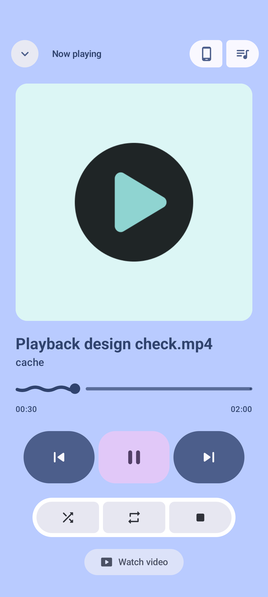 | 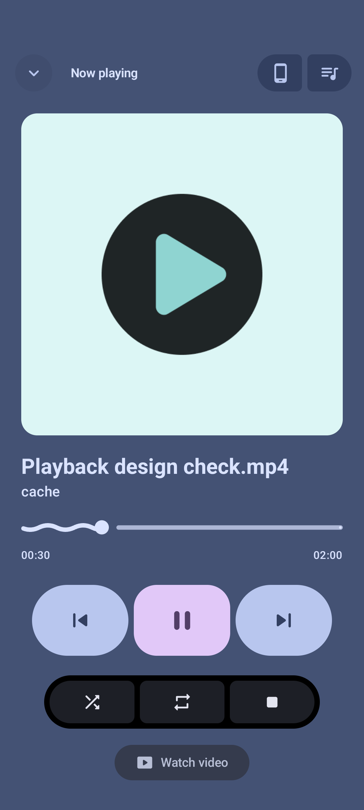 |
| Landscape, playing | 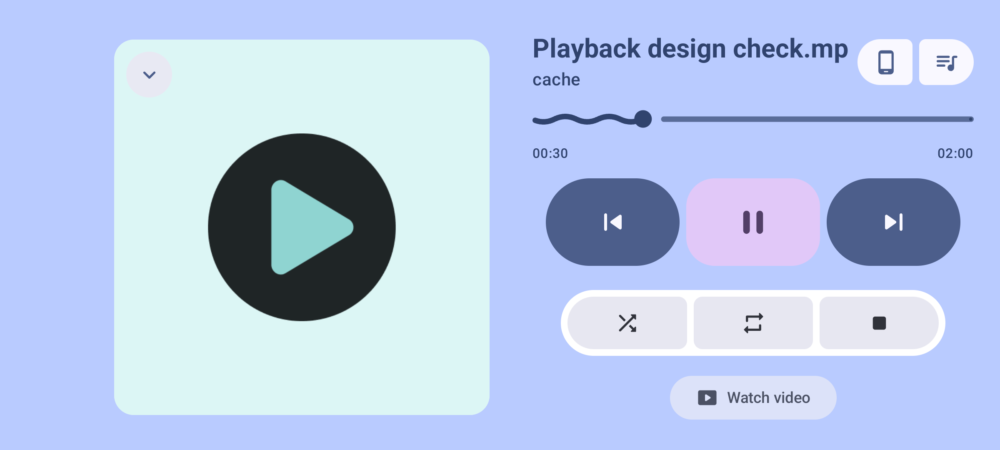 | 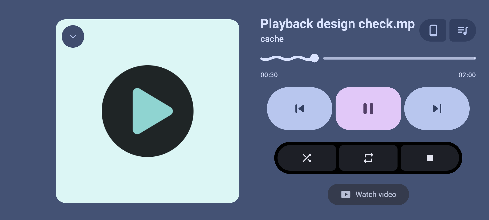 |
| Portrait, paused | 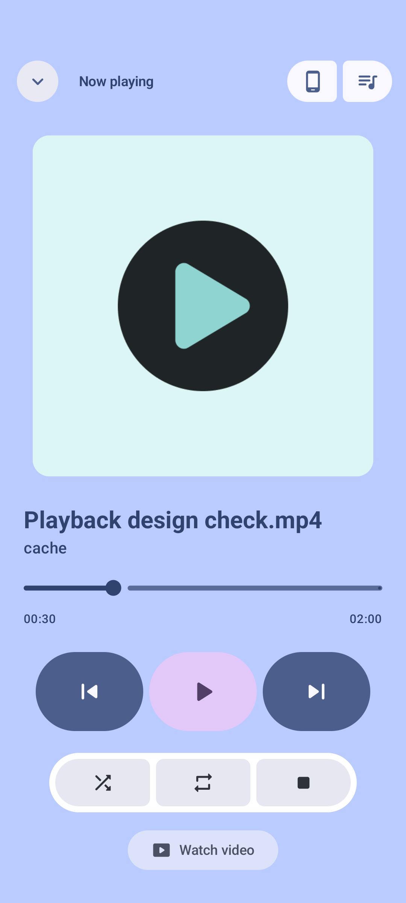 | 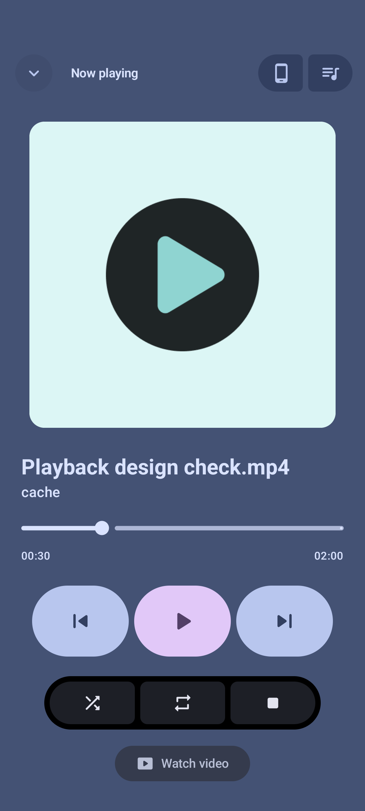 |
| Landscape, paused | 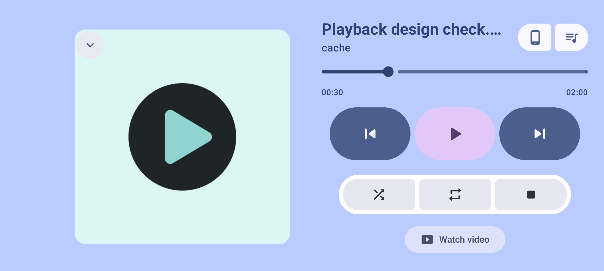 | 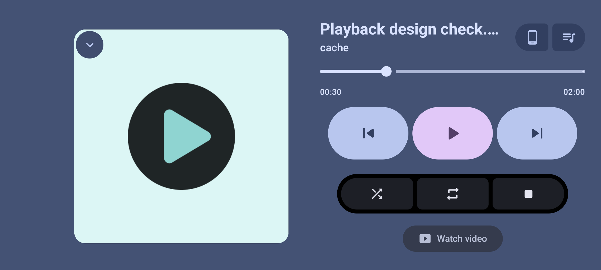 |
| Portrait, scrubbing | 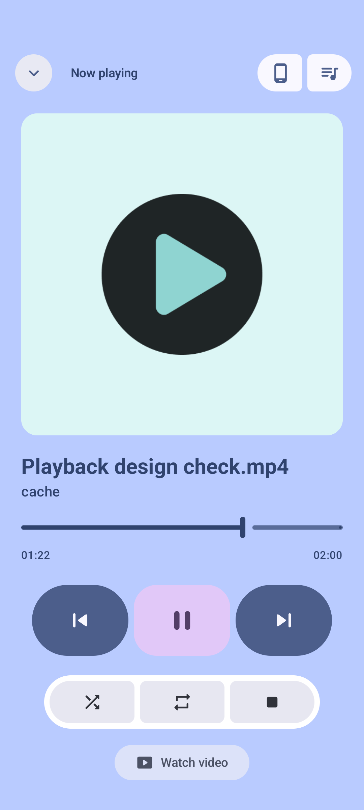 | 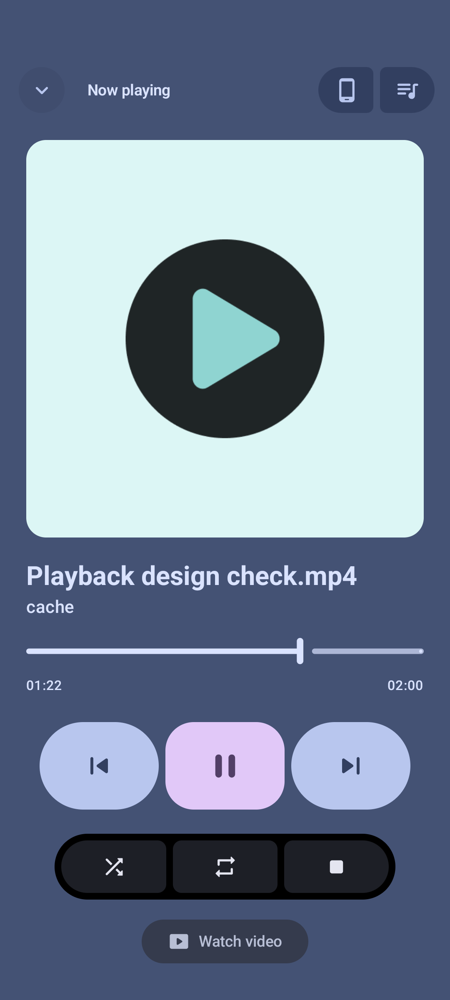 |
| Landscape, scrubbing | 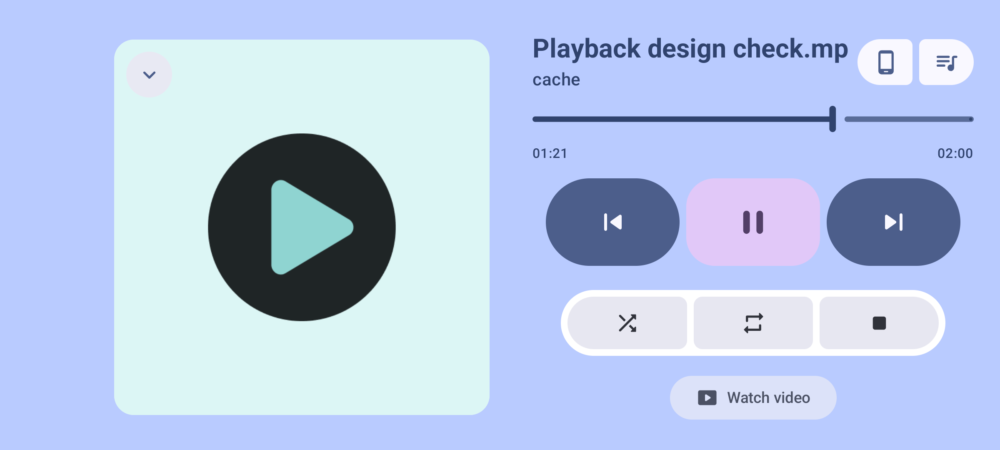 |  |

Screenshots contain only generated test media. Adjacent JSON files record component bounds in image coordinates for review. No private media, URI grants or capability URLs are included.

## Independent review and fixes

The first Claude Opus 5.5 review ran on `5a6bcb8c` and inspected all 12 original parity images plus the pinned reference source. It found no correctness defects, but identified two P2 and three P3 visual mismatches. All five are addressed:

| Finding | Correction | Regression/evidence |
| --- | --- | --- |
| P2: the track widened while the thumb narrowed, and was inset from the labels. | Full-width decorative wave/thumb layer independent of native Slider measurement; fixed native input geometry. The thumb is clamped at both ends in physical RTL/LTR coordinates. | Stable track bounds before/during/after scrubbing; label alignment; narrow/zero-width and RTL clamp tests; endpoint captures. |
| P2: 80% portrait artwork did not match the default no-peek presentation. | Full content-width square with the reference's artwork padding and paused scale. | The playing portrait artwork and metadata are both 954 px / 363.4 dp wide on Pixel_6a; large-text/RTL actions remain reachable in Compose tests. |
| P3: landscape collapse straddled the artwork edge. | Collapse lives in the same centered, unscaled square host, inset 8 dp. | Frame/inset bounds regression and refreshed landscape images. |
| P3: Now playing was crowded by a named receiver chip. | Hide that title while retaining weighted space during Connecting/Cast. Animate chip width/corners; clamp spring overshoot to valid corner sizes. | Local→named receiver→local transition, title exclusion, bounded chip width and queue visibility tests. |
| P3: long landscape filenames were permanently ellipsized. | Native marquee only during acknowledged playback when system motion permits; paused, Connecting/Lost and reduced-motion states retain bounded text. Observe motion-setting changes live with API24-compatible reads. | API24/36 setting regression; bounded/unbounded UI layout tests; actual Pixel_6a title pixels change over 2.4 seconds and return to native ellipsis after Pause. |

The second capture set contains 17 images: the original 12 light/dark portrait/landscape states, two held seek endpoints and three title-motion/paused frames. Track X bounds are identical in paused, playing and scrubbing states: **63–1017 px portrait** and **1278–2337 px landscape**, with the left edge equal to the time-label edge.

Additional evidence: [seek start](parity/dark-landscape-seek-start.png), [seek end](parity/dark-landscape-seek-end.png), [title before scrolling](parity/landscape-title-scroll-start.png), [title after scrolling](parity/landscape-title-scroll-end.png), [paused title](parity/landscape-title-paused.png).

A fresh Claude Opus 5.5 recheck is requested against the corrected source and captures. The reference-runtime comparison limitation above remains unchanged.
