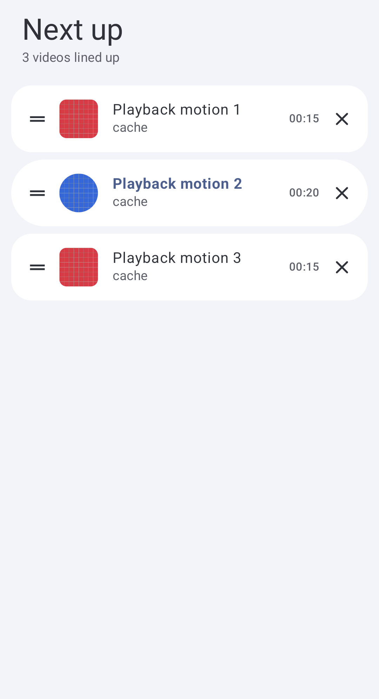
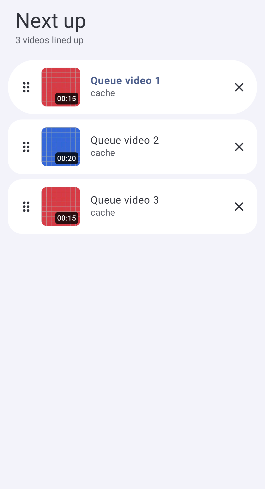
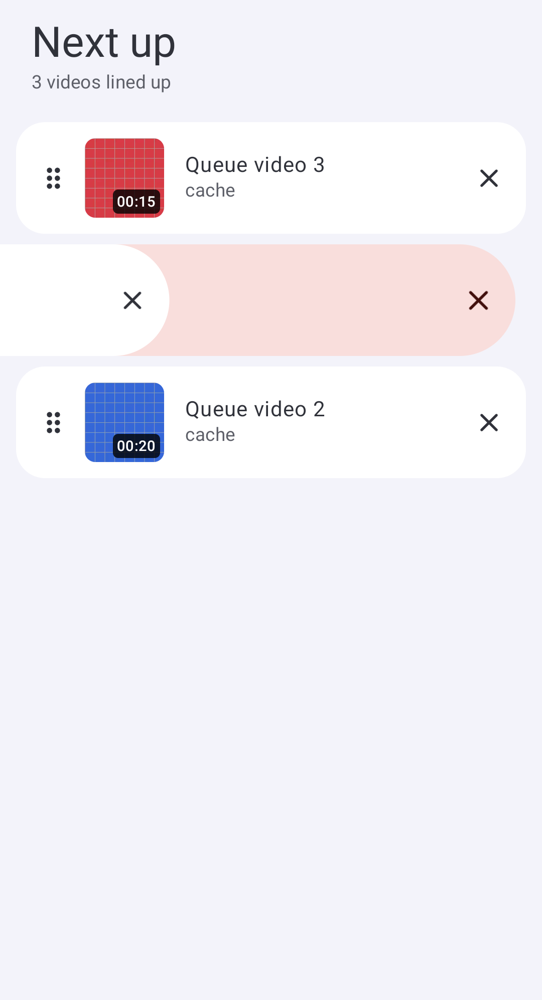

# Queue and compact dismissal polish

The user's five follow-up findings are addressed on the third stack layer. PixelPlayer remains a behavior/style reference; this implementation uses Compose Foundation, the installed reorder library and Next Player color roles. No reference source/assets or dependencies were added.

| Before | After |
| --- | --- |
| Compact content slid but its separate sheet background stayed behind. | The entire compact surface moves over a rounded removal reveal, with threshold feedback, spring-back on cancellation and an animated exit. Both swipe directions and four-second Undo remain. |
| Queue used a two-line handle and 42 dp artwork with duration beside it. | Rounded six-dot handle, 60 dp square artwork that accommodates large text, and a white-on-black duration badge on the image. Unknown durations retain the marker. |
| Queue removal required a button. | End-to-start swipe removal, reversed in RTL, gives a haptic at 40% travel. Buttons remain for accessibility/D-pad; the handle consumes its own drag and cannot start removal. |
| Reorder returned before its event-driven queue update. | The reorder callback resolves occurrence keys and waits for the observed move before accepting another. Existing library placement animation remains the sole placement animation. |
| Whole-entry padding shortened nested backgrounds, and hidden navigation left a bottom gradient strip. | Screen Scaffolds receive the playback reservation as insets; lists/forms/FABs/selection actions reserve reachable content while backgrounds draw to the window edge. System bars are counted once, and the hidden bar's gradient fades to zero with its existing extent. |

The gesture uses Foundation's horizontal drag recognizer because cancellation must roll back. A deeper cancellation regression demonstrated that native anchored dismissal could remove an item after Android cancelled the gesture. Physical offsets also use physical reveal alignment, so the icon stays on the revealed side in RTL. An exit animation cannot dismiss a replacement queue, including one whose visible item/metadata are unchanged.

Device testing also exposed a pre-existing removal edge: deleting the current final row caused Media3 to report ENDED with earlier items still queued. The queue now selects the previous item before removal, preserving playing/paused intent. That action requires its seek command; the final item remains protected.

## Verification

Root builds, tests and formatting pass: **903 tests in 157 XML suites, zero failures/errors/skips**. The XML was parsed rather than relying on Gradle's `ignoreFailures` success status.

The new shared regressions cover partial RTL reveal placement, large text, haptic-before-release, deep cancellation, duplicate occurrence removal, protected final items, denied commands, horizontal input on the handle, continuous reorder, the fullscreen queue caller and replacement playback during dismissal. A separate state regression covers current-final-row removal for paused and playing intent.

On the existing **Pixel_6a, API 37, arm64**, full acceptance passes for **35 Play + 18 standard** cases, with zero failure/error/skip status codes. This includes queue gestures/removal, local playing/paused Undo, nested settings edge/reachability, real-thumbnail paging, external API results/grants, completion and playlist compatibility. The queue flow injects one move per frame with layout waits, verifies order while the finger remains down, and checks the drag handle against the finger's expected position. All 20 [sampled positions](queue/queue-reorder-geometry.json) maintain the same 21 px (8 dp) touch-slop offset, including both index changes; maximum floating-point deviation is below 0.001 px. These are interaction/geometry checks, not a release-build frame-rate benchmark. The settings check compares background pixels at the middle and bottom edge and scrolls the final preference clear of the mini player.

Manual Device-panel testing additionally reordered the separate fullscreen queue in landscape, then swiped its current final row away: the previous video remained selected and paused with the queue open. The UI session was closed before instrumentation to avoid concurrent UiAutomation ownership.

An architect reviewed the final source and six saved frames and found no remaining blocker. The review was read-only and did not independently rerun device tests.

Latest Play APK installed on the connected **OPPO CPH2689, Android 16/API 36**, preserving app data. Physical haptic feel, Cast timing and same-version PixelPlayer playback parity were not checked. The existing high-bitrate 4K Cast buffering limitation remains outside this change.

## Evidence

| Previous queue | Larger artwork and duration badges |
| --- | --- |
|  |  |

| Compact dismissal reveal | Queue removal reveal |
| --- | --- |
|  |  |

Additional captures: [held reorder](queue/queue-reordering.png), [nested settings at the window edge](queue/queue-settings-edge-to-edge.png), [fullscreen landscape queue](queue/fullscreen-landscape.png). Test video artwork is generated; the fullscreen capture uses earlier app UI fixtures. No private media or capability URLs are published.
