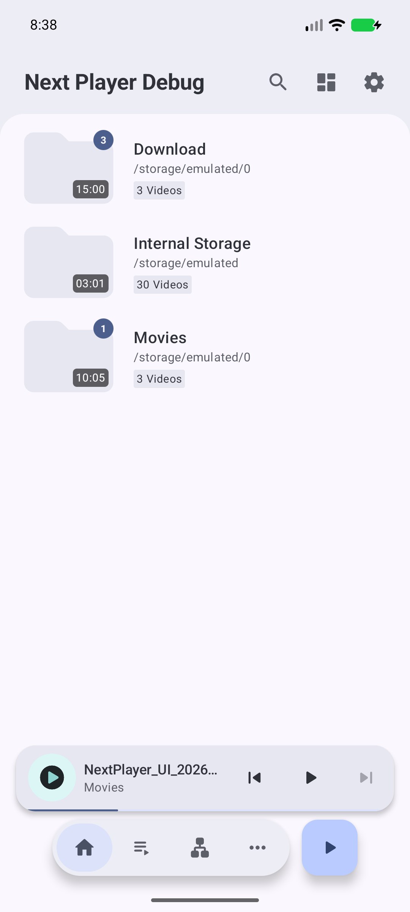
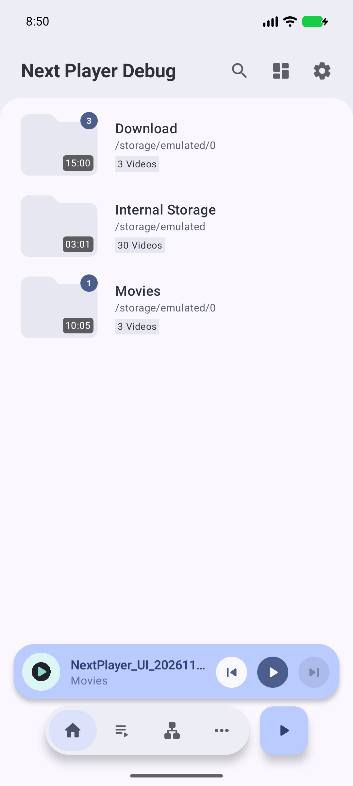
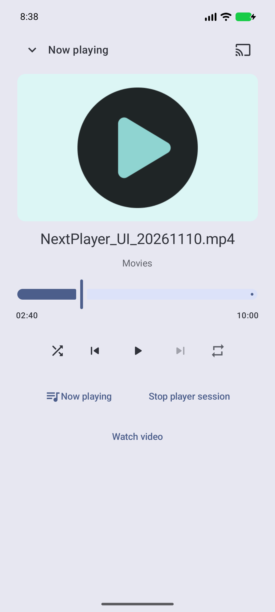
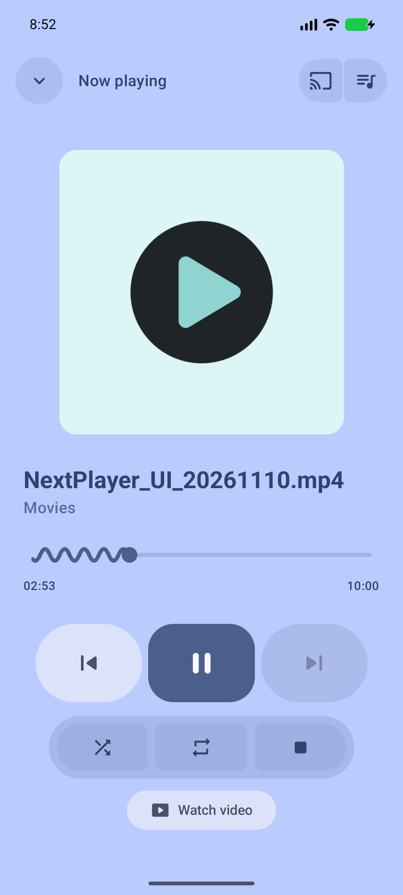

# Global playback controls verification

Third stack layer: `cast/global-playback-controls`, based on `cast/home-mini-player` (#2087), above #2086. The approved requirements remain in [the design](../global-playback-controls.md).

## Automated checks

Run with JDK 17 launcher, the repository's JVM 21 daemon criteria, and `ANDROID_HOME=/Users/anil/Library/Android/sdk`:

```sh
./gradlew assembleDebug :app:assemblePlayDebugAndroidTest :app:assembleStandardDebugAndroidTest test ktlintCheck --max-workers=2 \
  '-Dorg.gradle.jvmargs=-Xmx4096m -Dfile.encoding=UTF-8'
```

Current XML totals: **987 tests in 170 suites, zero failures, errors or skips**. XML is inspected because local tests use `ignoreFailures=true`.

Meaningful regressions cover:

- Service-owned four-second dismissal expiry, invalidation by new queues, paused/playing local restoration and playback settings.
- Paused receiver acknowledgment, mismatched/unsupported media, cancellation and a second explicit selection, failed automatic recovery without local autoplay, placeholder recovery, ongoing item/position snapshots and repeated late returns after Undo.
- Consumed resume hints on the current Cast item: restoring a dismissed queue after advancement retains live position and preserves other items' resume metadata.
- Persistent compact/expanded controls, denied commands, seek/output volume, artwork selection versus compact dismissal, slow expansion reversal, queue/Back hierarchy, PIN exclusion, RTL and 2× text.
- Existing local surface ownership, external launch/API compatibility, playback completion, subtitles and root D-pad traversal in both distributions.

## Queue duration subtitle follow-up

The latest [duration subtitle update](duration-subtitles.md) moves each timestamp below the video title and removes artwork badges. Normal queue interactions and 200% RTL rendering pass in two cases per distribution on Pixel_6a API 37. A synthetic 100-hour duration renders in full. Root tests remain 987/170 suites with no failures/errors/skips.

## Foreground continuity follow-up

The [foreground-continuity repair](foreground-continuity.md) keeps active controls mounted while backgrounded and covers cold expanded entry until connection completes. Final Pixel_6a API 37 results: 43 Play acceptance cases and nine standard checks, all passing. The new grant checks keep Main alive/backgrounded through Stop and Undo expiry and confirm release without requiring Main to finish. The current root XML totals above include this repair; older acceptance groups below are historical.

## Queue lifecycle follow-up

The November 13 [queue lifecycle repair](queue-lifecycle.md) retains portrait half/full queue and landscape full queue across background/foreground and same-orientation Activity recreation. Three targeted cases pass in each distribution on Pixel_6a API 37; panel geometry and paused intent are preserved. The broader acceptance runs below belong to preceding rounds.

## Device acceptance

Latest device: the existing `Pixel_6a`, API 37, arm64 emulator. The initial implementation had also passed the same focused runs on `NextPlayer_Cast_QA_API35` (Android 15 / API 35); that AVD is now closed. Manual UI actions use the thread's Device panel and its returned `agent-device` CLI. The second parity round uses the project's AndroidX runner for acceptance and Compose screenshot artifacts. The UI session is closed before instrumentation to avoid concurrent UiAutomation ownership.

Prior dismissal-reference follow-up acceptance:

| Distribution | Tests | Result |
| --- | ---: | --- |
| Play full acceptance | 36 | Zero failures/errors/skips |
| Standard UI + external handoff | 19 | Zero failures/errors/skips |

Both runs include the 18-case mini-player UI group, including compact Undo placement/countdown/Close, playing/paused restoration, queue-removal Undo and same-URI replacement invalidation. The fullscreen-return case waits for the separate Activity to be destroyed before the Main assertions; this removes the listener-cancellation teardown race seen in the initial combined run. The earlier motion-round runs (33 Play, 15 Play UI and 16 standard UI/external) remain documented in its historical report.

Play full acceptance covers `MiniPlayerIntegrationTest`, `PlayerApiRequestRegressionTest`, `PlayerApiLaunchOptionsTest`, `BackgroundPlaybackCompletionTest` and `PlaylistCompletionTest`. Standard covers `MiniPlayerIntegrationTest` plus the external handoff/Undo/grants regression. These are focused acceptance runs, not the entire instrumentation suite.

Flows include root tabs and recreation, nested settings, compact/expanded entry, Watch video return with paused position, notification entry from direct fullscreen with background playback disabled, playing/paused Undo, Stop persistence, vault PIN exclusion, playlist-form text entry without stopping playback, external API results/grants, queue completion and autoplay/repeat compatibility.

The Cast dismissal snapshot correction and visual refinement were included in the full root checks and the latest Pixel_6a device runs. The Play APK is restored after standard verification.

The external-caller regression runs under a different UID and checks result code, URI and position, then dismisses/restores the paused queue, removes/restores an externally granted item through queue Undo, verifies URI/subtitle access throughout both Undo flows, plays another queued item, and confirms media/subtitle grant revocation after all service controllers are released.

## Current queue and dismissal follow-up

The latest [dismissal reference correction](dismissal-review.md) adds a compact-height countdown Undo pill, resisted translated-width queue capsule, focus/accessibility removal actions and occurrence-aware queue Undo. It also rejects delayed additions after Stop or replacement and verifies retained external video/subtitle grants across queue removal and restoration.

See [the queue follow-up](queue-review.md) for destructive swipe reveals, six-dot handles, larger artwork/duration badges, haptic/cancellation/replacement guards, continuous reorder checks and edge-to-edge nested screens. Device testing also fixed Media3 ending playback after removing the current final row despite earlier queued items. Latest root checks cover both distributions; the connected OPPO installation preserves data.

## Playback motion follow-up

The preceding motion round is documented in [the motion follow-up](motion-review.md), with 13 fresh PNGs and 10 geometry JSON files. It adds generated 15/20-second video checks at 1× and 2×, real artwork paging including duplicate queue items, queue duration/reorder/removal, compact navigation continuity, and a partial-transition rail clipping fixture. The four light/dark × portrait/landscape artwork crops are pixel-identical between paused and playing states, confirming that play/pause no longer scales artwork.

The screenshots below and in the earlier parity review are historical; the user's square-artwork/no-pause-scaling follow-up supersedes those visual choices.

## Visual refinement evidence

The user requested closer PixelPlayer styling after the initial implementation. Compact controls now use 36 dp filled circles and 44 dp circular artwork; expanded controls use square artwork, an 80 dp filled transport row with pressed-width feedback, a segmented shuffle/repeat/Stop row, filled header actions and a wavy seek track. The play shape and artwork size animate between playing and paused states. Next Player color roles, typography and icons remain in use. Existing Material 3 components provide controls and animations; no dependency was added.

Layout selection uses full-window constraints rather than the animated sheet height, so an artwork-origin drag does not replace its gesture node halfway through expansion/collapse. A regression checks that a slow downward drag crosses halfway and finishes collapsed. Separate coverage checks square artwork, transport height and secondary-row separation.

All screenshots use a generated test pattern on the existing **Pixel_6a / API 37 / arm64** emulator. The before images are the initial third-layer implementation at `97191ecfa63ad24dd0dbfd654cc908b1b52398d2`, not parent #2087. No parent branch was modified. The earlier activity-launch problem was resolved by passing an explicit package/activity component to the Device CLI. The old QA AVD was closed and all subsequent UI verification used Pixel_6a, as requested.

| Before | After |
| --- | --- |
|  |  |
|  |  |

Additional states: [compact playing](after-compact-playing.png), [expanded paused](after-expanded-paused.png), [landscape](after-landscape.png), [accessibility-large text](after-large-text.png).

Manual flows checked paused/playing controls, an artwork-origin downward drag through halfway to compact controls without interrupting playback, portrait/landscape rotation, landscape scrolling to the lower controls, enlarged text and collapse/expanded entry with system animations disabled. The original text-size and animation settings were restored. RTL/2× text, capability gating, seek/output semantics and D-pad traversal remain covered by automated tests. Manual window resizing, D-pad input and a visual IME-position audit remain unchecked.

## Second parity round

See [the parity comparison](parity-review.md) for the landscape/header/seek/contrast corrections, current screenshots and review evidence. The latest instrumentation verifies actual title movement/paused ellipsis and held seek endpoints, in addition to rotation across light/dark and playing/paused states, plus touch scrubbing without collapsing the overlay. It asserts all expanded actions are visible in landscape without scrolling. After the final large-window/collapse and title-fade corrections, both distributions passed the two visual/native-motion cases again. Refreshed title PNGs have at most 2/255 channel difference from the background at the viewport edges while interior text remains above 80/255; a pixel self-check required edge differences ≤8/255. The paused artwork capture now waits for its animation to settle.

## Limits

- The latest Play build was installed on the connected OPPO CPH2689 and Pixel_6a without clearing data. The visual refinement was tested on Pixel_6a only, following the user's instruction. No phone/receiver runtime playback claim is made; Cast connection/recovery timing still needs hardware verification.
- The prior original 4K/~59fps/~56 Mbps Camera buffering problem remains outside this UI layer. No transcoding or server-performance fix is claimed.
- No PixelPlayer source or assets were copied. No dependencies or `fastlane/` files changed.
